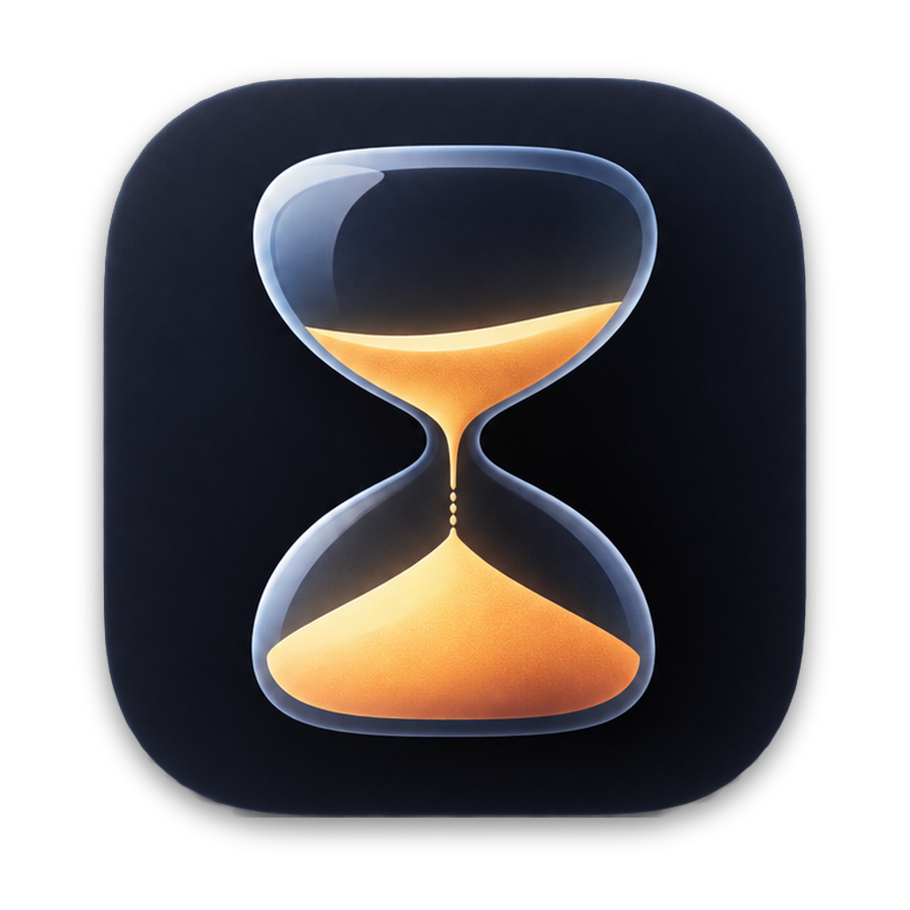

<p align="center">
  
</p>

<h1 align="center">TinyTimer</h1>

<p align="center">Menu bar time tracker for macOS</p>

<p align="center">
  <a href="https://github.com/Yurich84/TinyTimer/actions/workflows/release.yml"></a>
</p>

The initial of the activity in a circle + `42:17` / `1:42:17` in the macOS status bar. While running, the circle is filled and shows the current activity. After a stop, the circle is outlined and the item keeps the stopped activity and its time; a click starts that activity again. With nothing tracked today, it shows the default activity and `00:00`. The timer keeps the hour digits of today's total, so the item does not change width when you start or stop.
Activities are configurable in Settings; the defaults are Development, Investigation, Meeting.
Starting an activity stops the previous one. Every interval is a row in SQLite
(`~/Library/Application Support/TinyTimer/tinytimer.sqlite`, table `entries(id, activity, start, end)`;
the activity list is in table `activities(id, name, position)`).

- **Left click** — stop the running activity, or start the default one (Settings → Default activity)
- **Right click** (or ⌃-click) — menu
- **⌥⌘T** — quick switch popup (↑↓, Enter, 1–9 for the first nine activities, Esc)
- **Statistics** — window with History / Statistics / Timeline tabs and arrows to go back and forth.
  In History: double-click or right-click a row to edit or delete it, **Add…** for a manual entry.
  Overlapping entries are rejected. Statistics and Timeline show a day, a week or a month (switch at the top).
  Timeline draws every day as one bar from 00 to 24 with a color per activity (Settings → Activities).
  Drag an edge of an interval to change it: up to the next interval, or to the end of the day (or now).
  Intervals that touch move together. A week shows 7 bars, a month scrolls vertically through all its days.
- **Export CSV** — format chosen in the save panel (`HH:MM:SS` or decimal hours):
  one row per day (`date,<activity…>,total`), one row per day per activity (`date,activity,duration`),
  or one row per entry (`date,activity,start,end,duration`)
- **Settings → Activities** — add an activity (name + **Add**), move it up or down, or delete it.
  Names are trimmed and must be unique (case is ignored). The last activity cannot be deleted.
  Deleting an activity keeps its entries: they stay in History, Statistics and CSV exports.
- **Settings → Activities → color swatch** — the color of an activity in Statistics and Timeline
- **Settings → Timer shows** — time since the last switch, or today's total for the current activity
- Sleep stops the running entry; it resumes on wake if the sleep was shorter than 15 min.

## Download

**[Download the latest TinyTimer.zip](https://github.com/Yurich84/TinyTimer/releases/latest/download/TinyTimer.zip)**
· [all releases](https://github.com/Yurich84/TinyTimer/releases)

Requires Apple Silicon (arm64) and macOS 14 or later. Every push to `main` builds a new release.

Unzip and move `TinyTimer.app` to `/Applications`. The app is ad-hoc signed and not notarized,
so Gatekeeper blocks the first launch. To allow it, do one of these:

- Run `xattr -dr com.apple.quarantine /Applications/TinyTimer.app`
- Open the app once, then go to System Settings → Privacy & Security and click **Open Anyway**

## Build

Works with Command Line Tools only (no Xcode):

```sh
./bundle.sh --open            # build/TinyTimer.app
./bundle.sh --install --open  # copy to /Applications (needed for Launch at login)
swift run --build-system native TinyTimer --selftest
swift run --build-system native TinyTimer --snapshot /tmp   # render SwiftUI screens to PNG
```

With Xcode (needs [XcodeGen](https://github.com/yonaskolb/XcodeGen); the project is generated from `project.yml`):

```sh
./xcode-export.sh                   # archive + export -> build/export/TinyTimer.app
./xcode-export.sh --install --open
xcodegen generate && open TinyTimer.xcodeproj
```

SwiftUI's `@State` macro plugin is not shipped with Command Line Tools, so views keep state
in `ObservableObject` models instead.
